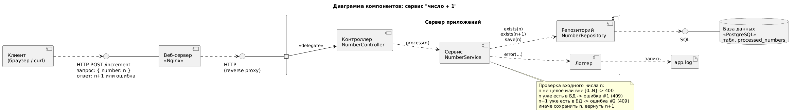
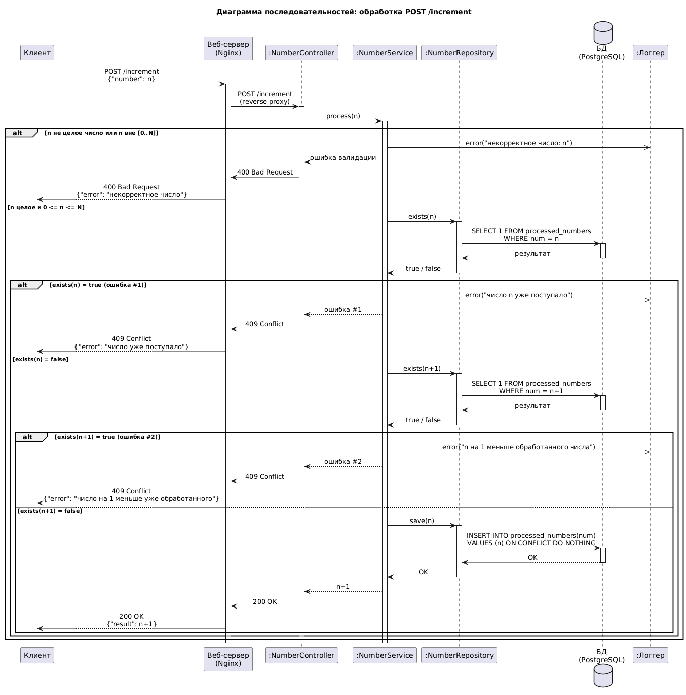

# Сервис «число + 1»

Трёхуровневая система: клиент → веб-сервер (Nginx) → сервер приложений (Flask + Gunicorn) → БД (PostgreSQL).

Принимает `POST /increment` с телом `{"number": n}` и возвращает `n + 1`.

## Диаграммы





## Что где лежит

```
client.py            клиент
nginx/nginx.conf     веб-сервер, проксирует POST /increment на приложение
app/
  main.py            сборка приложения
  controller.py      NumberController - принимает запрос, отдает HTTP-ответ
  service.py         NumberService - проверки и обе исключительные ситуации
  repository.py      NumberRepository - запросы к БД
  logger.py          настройка лога
  test_service.py    тесты логики сервиса
db/init.sql          таблица processed_numbers
docker-compose.yml   запуск всех уровней
docs/                UML-диаграммы (компонентов и последовательностей), png + исходники PlantUML
```

Названия классов совпадают с компонентами на диаграммах.

## Запуск

```
docker compose up --build
```

## Проверка

```
python client.py 5     # 200 {'result': 6}
python client.py 5     # 409 число уже поступало (ошибка #1)
python client.py 4     # 409 число на единицу меньше уже обработанного (ошибка #2)
python client.py -1    # 400 некорректное число
```

Лог пишется в `logs/app.log`.

## Ответы сервера

| Ситуация | Код | Тело |
|---|---|---|
| всё хорошо | 200 | `{"result": n+1}` |
| не целое число или вне [0..N] | 400 | `{"error": "..."}` |
| ошибка #1: число уже поступало | 409 | `{"error": "..."}` |
| ошибка #2: число на 1 меньше обработанного | 409 | `{"error": "..."}` |

N задается переменной `MAX_N` в docker-compose.yml (по умолчанию 1000000).